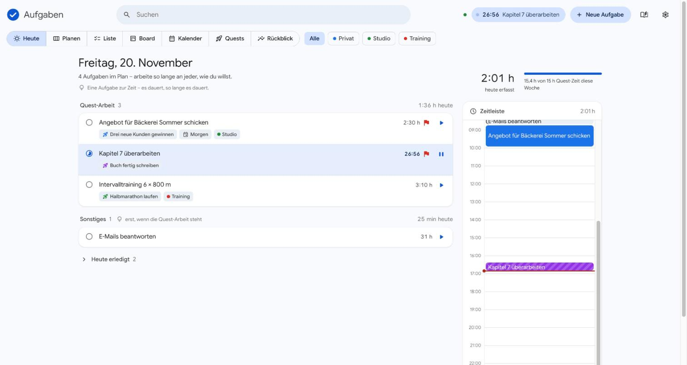
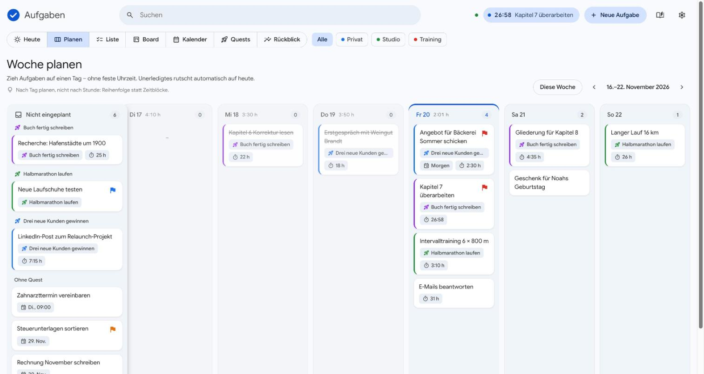
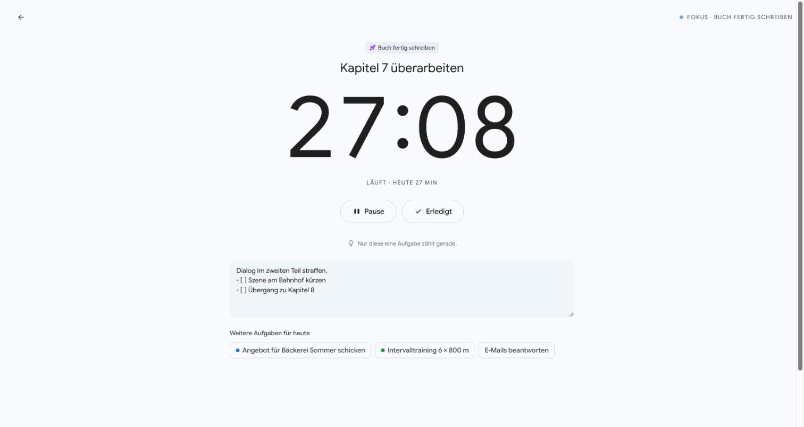
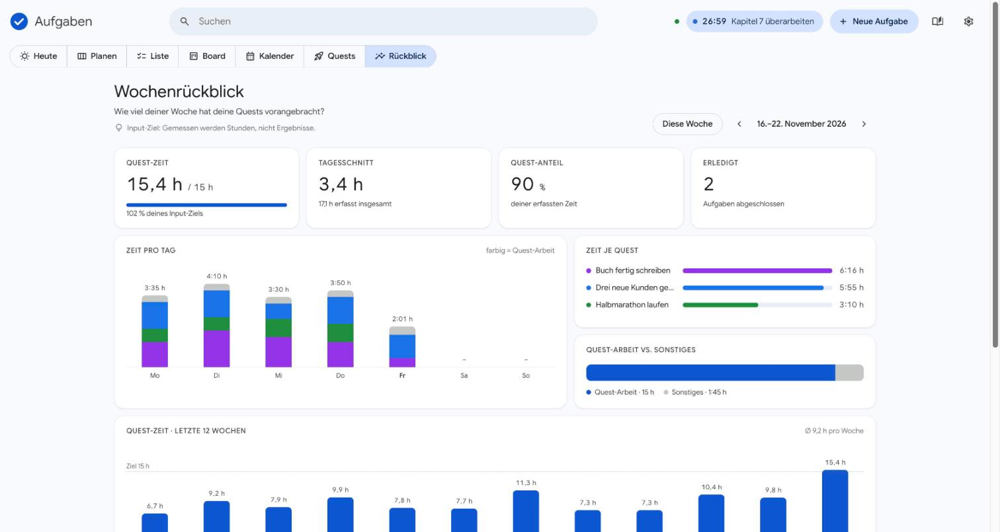
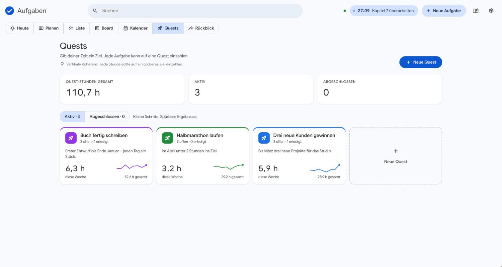
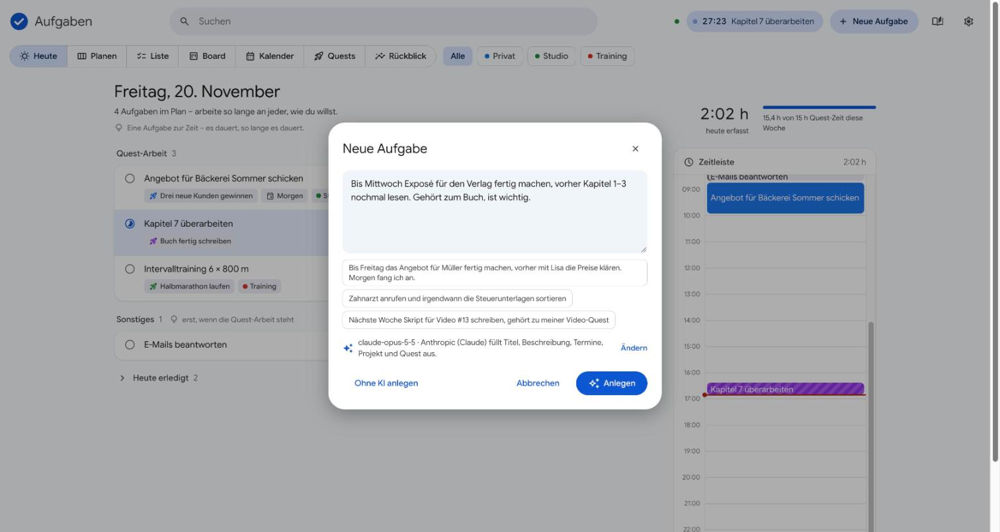
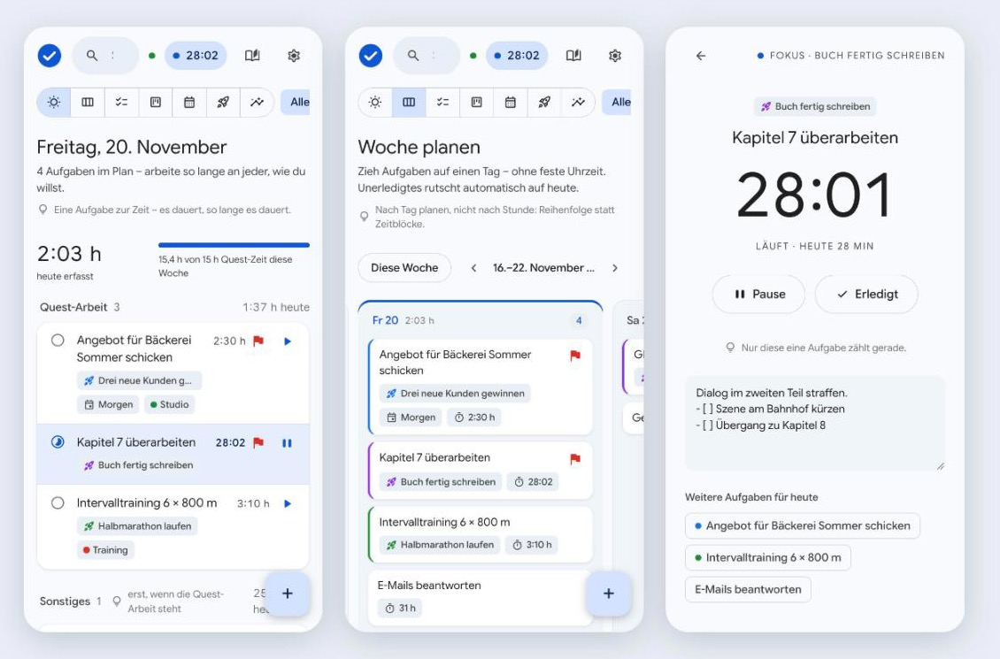

# quest-todo-mcp

Persönliche Aufgabenliste als MCP-Server für Claude – mit einer schnellen Weboberfläche, die sich als App
installieren lässt. Aufgaben entstehen im Gespräch mit Claude, per Beschreibung an ein Sprachmodell deiner
Wahl oder direkt in der Oberfläche. Geplant wird nach Tagen statt nach Uhrzeiten, gearbeitet an einer Sache
zur Zeit, und die erfasste Zeit zeigt, wie viel davon in deine Ziele fließt.



| | |
| --- | --- |
|  |  |
|  |  |
|  |  |

Alle Ansichten: Heute, Planen, Liste, Board, Kalender (Monat und Woche), Quests, Rückblick, Fokus. Karten
lassen sich ziehen (Status, Datum, Tag im Plan), jede Änderung lässt sich über die Meldung unten
rückgängig machen, und alle offenen Geräte bleiben in Echtzeit synchron.

## Ausprobieren

```sh
export TODO_ACCESS_KEY=$(openssl rand -hex 32) TODO_DB_PATH=data/demo.db
uv run python scripts/seed_demo.py   # ausgedachte Aufgaben, Quests und 12 Wochen Zeiterfassung
uv run todo-mcp                      # http://localhost:8000, Anmelden mit $TODO_ACCESS_KEY
```

## Quests, Tagesplan & Fokus

Angelehnt an [Quest](https://quest.app): Ziele → Aufgaben im Tagesplan → erfasste Zeit.

- **Quests** sind übergeordnete Ziele. Aufgaben werden einer Quest zugeordnet; Zeit an solchen Aufgaben
  zählt als Quest-Zeit. Quests legt man in der Weboberfläche oder über Claude an.
- **Planen:** Aufgaben per Ziehen auf Wochentage verteilen (`plan_date`, ohne Uhrzeit, unabhängig von
  der Fälligkeit). Offene Aufgaben aus vergangenen Tagen rutschen automatisch auf heute.
- **Heute:** der Tagesplan, getrennt in Quest-Arbeit und Sonstiges, mit Play-Knopf je Aufgabe,
  Vorschlägen (fällig oder in Arbeit) und einer Zeitleiste der heute erfassten Zeit.
- **Fokus:** Vollbild-Stoppuhr für eine Aufgabe, Pause, Erledigt, Notizen und schneller Wechsel zu
  anderen Aufgaben des Tages (Leertaste startet/pausiert). Es läuft immer höchstens ein Timer; er läuft
  auf dem Server weiter, auch wenn die Seite geschlossen ist. Sitzungen unter 10 Sekunden werden verworfen.
- **Kalender → Woche:** erfasste Zeit als Wochenraster; Einträge nachtragen, korrigieren, löschen.
- **Rückblick:** Quest-Zeit gegenüber dem Wochenziel (Standard 20 h, anklickbar), Tagesschnitt,
  Quest-Anteil, Zeit pro Tag und Quest sowie die letzten 12 Wochen.

Status: Offen (`todo`), In Arbeit (`doing`), Zurückgestellt (`deferred`), Erledigt (`done`).
Zurückgestellte Aufgaben ruhen: Sie fehlen im Überblick und in der Standardsuche, lösen keine
Erinnerungen aus und stehen in der Liste eingeklappt unter „Zurückgestellt“.

## Aufgaben per KI anlegen

- **Neue Aufgabe** (Knopf oben, am Handy „+“ unten rechts, Taste `N`): Aufgabe in eigenen Worten
  beschreiben – ein Sprachmodell füllt Titel, Beschreibung, Frist, geplanten Tag, Priorität, Projekt,
  Tags und Quest aus; mehrere Aufgaben in einer Beschreibung werden getrennt angelegt. Ohne KI wird die
  erste Zeile zum Titel. Alles lässt sich rückgängig machen.
- **Modellunabhängig** (Einstellungen → KI-Assistent): Anthropic über das offizielle SDK mit Structured
  Outputs (Standard `claude-opus-5-5`, Effort `low`, serverseitiger Fallback bei Ablehnungen); OpenAI,
  Google Gemini, OpenRouter, Mistral oder ein eigener OpenAI-kompatibler `https://`-Endpunkt über
  Chat Completions mit Tool-Aufruf. „Modelle laden“ fragt die verfügbaren Modelle ab und prüft den Key.
- Der API-Key liegt verschlüsselt in der Datenbank (Schlüssel abgeleitet aus `TODO_ACCESS_KEY`) und wird
  nie an den Browser zurückgegeben. Wird `TODO_ACCESS_KEY` geändert, muss der Key neu eingetragen werden.
- **Skill für Claude-Apps** (Einstellungen → Skill herunterladen, `/skill/aufgaben-anlegen.zip`): gleiche
  Anleitung wie der Assistent, damit Claude in claude.ai, Desktop, Handy und Claude Code Aufgaben über den
  todo-Connector genauso anlegt. Anleitung und Beispiele stehen an einer Stelle in `agent.py`.

## Echtzeit & Performance

- Alle offenen Oberflächen bleiben live synchron: Jede Änderung (Web, Handy, Claude über MCP) schickt der
  Server per Server-Sent Events (`/api/events`) als Ereignis mit nur den geänderten Zeilen, typischerweise
  in unter 50 ms. Schreiben läuft weiter über REST. Nach einem Verbindungsabbruch verbindet sich die Seite
  selbst neu und gleicht per ETag ab; ohne Verbindung fragt sie alle 10 s nach.
- Der Verteiler liegt im Prozess – das passt zu genau einer Fly-Maschine mit SQLite. Für mehrere Maschinen
  bräuchte es einen gemeinsamen Kanal (z. B. Redis Pub/Sub oder Postgres LISTEN/NOTIFY).
- Seite und Daten gehen gzip-komprimiert raus (Seite ≈ 32 KB, bei Wiederkehr 304), die Symbolschrift wird
  auf die genutzten Icons beschränkt (≈ 16 KB statt 1,4 MB). Neue Icons in `icon_names` im `<head>` ergänzen.

## Auth & Sicherheit

Ein geheimer Key (`TODO_ACCESS_KEY`) schützt alles, optional zusätzlich ein zweiter Faktor:

| Zugang | Wie |
| --- | --- |
| Claude Code, Skripte | Header `Authorization: Bearer <key>` – nur ohne 2FA; mit 2FA per OAuth wie unten |
| claude.ai, Claude Desktop, Claude-App (Handy), Claude Code mit 2FA | OAuth – beim Verbinden auf der Freigabeseite Key (und Code) eingeben |
| Website | Login mit Key (und Code), danach 90 Tage Cookie; Schreibzugriffe nur von der eigenen Origin |

- **Zwei-Faktor-Anmeldung** (Einstellungen → Sicherheit): Einmalcodes aus einer Authenticator-App (TOTP),
  dazu 8 Wiederherstellungscodes. Mit 2FA gilt der Key allein nirgends mehr – auch nicht als Bearer-Header.
  Beim Einschalten werden alle anderen Sitzungen und Claude-Verbindungen getrennt. Claude Code danach per
  OAuth verbinden: `claude mcp add --transport http --scope user todo https://<app>.fly.dev/mcp`, dann `/mcp`
  → Authentifizieren.
- **Überall abmelden** (Einstellungen → Sicherheit) beendet alle Browser-Sitzungen und OAuth-Verbindungen.
- **Key wechseln** (`fly secrets set TODO_ACCESS_KEY=…`): Beim Start werden alle OAuth-Clients und -Tokens
  gelöscht, alle Cookies ungültig; 2FA und der gespeicherte LLM-Key werden zurückgesetzt (sie sind mit dem
  alten Key verschlüsselt).
- **Handy und Wiederherstellungscodes verloren:** `fly ssh console -a <app> -C todo-mcp-reset-2fa`.
- OAuth: PKCE Pflicht, Codes nur an `claude.ai`/`claude.com` und lokale Clients; die Freigabeseite verlangt
  immer Key (und Code) und zeigt das Ziel. Tokens werden nur als SHA-256-Hash gespeichert; Access-Tokens
  laufen nach 1 h ab, Refresh-Tokens (90 Tage) rotieren. Ungenutzte Client-Registrierungen werden begrenzt.
- Nach 10 Fehlversuchen pro IP ist der Login 15 Minuten gesperrt; Formulare fremder Seiten zählen nicht mit.
- Header: CSP (Hauptseite nur mit Hash des eigenen Skripts), HSTS, `frame-ancestors 'self'`/`X-Frame-Options: SAMEORIGIN` (keine fremden Seiten),
  `nosniff`, `Referrer-Policy`. Anfragen über 1 MB werden abgelehnt.

## Lokal starten

```sh
TODO_ACCESS_KEY=$(openssl rand -hex 32) uv run todo-mcp   # http://localhost:8000
```

Umgebungsvariablen: `TODO_ACCESS_KEY` (Pflicht, ≥ 24 Zeichen), `TODO_PUBLIC_URL` (Standard
`http://localhost:8000`), `TODO_DB_PATH` (Standard `data/todo.db`), `TODO_TIMEZONE` (Standard
`Europe/Berlin`), `PORT`.

## Deployment (Fly.io)

```sh
cp fly.toml.example fly.toml   # App-Name und TODO_PUBLIC_URL anpassen
fly apps create <app>
fly volumes create todo_data --region fra --size 1 -a <app>
fly secrets set TODO_ACCESS_KEY=$(openssl rand -hex 32) -a <app>
fly deploy --ha=false
```

Nur eine Maschine (SQLite auf dem Volume). Sie läuft durchgehend, damit Erinnerungen pünktlich
verschickt werden.

## Android-App & Benachrichtigungen

Die Website ist eine installierbare PWA: in Chrome auf Android öffnen, anmelden, Menü (⋮) →
„App installieren“. In der App über die Glocke Benachrichtigungen aktivieren.

Push-Nachrichten (Web Push mit VAPID; der Schlüssel wird beim ersten Start erzeugt und in der Datenbank
gespeichert):

- zur Fälligkeit jeder offenen Aufgabe mit Uhrzeit (verpasste werden bis 15 Minuten nachgeholt)
- um 20:00 Uhr ein Ausblick auf alles, was morgen fällig ist (nur wenn etwas ansteht)

## Verbinden

- **Claude Code:** `claude mcp add --transport http --scope user todo https://<app>.fly.dev/mcp --header "Authorization: Bearer <key>"`
- **claude.ai / Handy:** Einstellungen → Connectors → *Add custom connector* → URL `https://<app>.fly.dev/mcp`,
  dann *Connect* und den Key eingeben. Der Connector steht danach auch in der Handy-App zur Verfügung.

## MCP-Tools

`overview`, `list_tasks`, `get_task`, `list_projects`, `add_task`, `update_task`, `complete_tasks`, `delete_tasks`,
`list_quests`, `add_quest`, `update_quest`, `start_focus`, `stop_focus`, `time_report`
